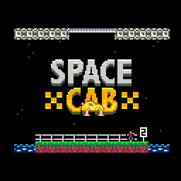

<h3>Space Cab for the CHGame handheld</h3>

Vampirics and filmote's Pokitto tribute to <i>Space Taxi</i>, ported from its C++.

<a href="#controls">How to play</a> · <a href="#building">Building it</a> · <a href="#credits-and-licence">Credits and licence</a>

## About the game

Fly your cab between the platforms: pick up the fares, drop them off where
they ask, and watch your fuel. Put the landing gear down before you land,
and don't hit the walls.

[Space Cab](https://github.com/Press-Play-On-Tape/SpaceCab_Pokitto) was made
for the Pokitto by Vampirics (graphics) and filmote (code), as a tribute to
the Commodore 64's *Space Taxi*. This port runs the game's own C++ on CHGame,
with a small stand-in for the parts of the Pokitto library it uses.

### Controls

| Button | Action |
|---|---|
| A | Thruster |
| B | Landing gear |
| LEFT / RIGHT | Steer |
| START | Pause (the Pokitto's C); held 3 s, back to the CHGame menu |

On the title screen the cab is yours to fly: pick up the passenger and fly
out of the top of the screen to start a game, or drop them on the
left-hand pad to see the high scores.

### Features

- **The original game,** its 13 levels from the SpaceCab_V1.0.2 release.
- **The original graphics,** drawn 1:1: the Pokitto's 110x88 screen in the
  middle of CHGame's 128x128 panel, at 60 frames a second.
- **High scores saved** in the CHGame's flash.
- **Sound on the piezo:** short tones in place of the Pokitto's recorded
  voices and theme tune, which are not included.

## How it works

- **`SpaceCab/src/game/`** is the game's own source, changed only where
  CHGame needs it. Each change is commented, for example where the levels
  are read from flash instead of the Pokitto's SD card.
- **`SpaceCab/src/game/Pokitto.*`** re-implements the parts of the Pokitto
  library the game calls: drawing, buttons, saving.
- **`SpaceCab/SpaceCab.ino`** runs the game's loop and sends the screen to
  the panel each frame.

## Building

Needs Python 3 (with Pillow and ziglang, for the simulator), arduino-cli and
the CHGame board package, as any CHGame game (`chgame/tools/README.md`).
`cl` (Git Bash, Linux, macOS) and `cl.cmd` (Windows) run the vendored CHGame
tools on the sketch:

| Command | What |
|---|---|
| `./cl build` | the release image |
| `./cl upload` | onto the board over USB |
| `./cl run SpaceCab/tools/scripts/smoke.txt out/smoke` | a script in the simulator |
| `./cl test` / `./cl check` | the host tests / everything that needs no board |

The README's GIF: `./cl gif` records the title (`gameplay.txt`); the level
clips come from `gameplay_level.txt` run in a build that starts in level 1
(`python SpaceCab/tools/chsim/chdrive.py --sim SpaceCab -D SC_TEST_PLAY
SpaceCab/tools/scripts/gameplay_level.txt SpaceCab/out/gameplay`, from the
repository root), then `./cl gif --no-run` joins them.

## Credits and licence

- **The game:** [Space Cab](https://github.com/Press-Play-On-Tape/SpaceCab_Pokitto)
  for the Pokitto, graphics by Vampirics and code by filmote (Press Play On
  Tape), with thanks to Pharap. It is free software under the
  **GNU General Public License v3**, and so is this port: see
  [LICENSE](LICENSE) and [SpaceCab/NOTICE](SpaceCab/NOTICE).
- **Font:** `SpaceCab/src/game/Font3x5.cpp` is the Pokitto library's
  font3x5 (Aurélien Rodot's Gamebuino font, LGPL 3).
- **The CHGame libraries and tools** in `chgame/` are bateske's
  [CHGame](https://github.com/bateske/CHGame), under their own
  GPL-compatible licences ([chgame/LICENSE](chgame/LICENSE),
  [chgame/NOTICE](chgame/NOTICE)).

## Acknowledgments

Ported by Jadflat with the help of Claude (Anthropic). The port's
changes are Copyright 2026 Jadflat, under the GNU GPL v3.

*Space Taxi* (1984) is John F. Kutcher's. This port is unofficial and not
endorsed by the original authors.

Built on CHGame, Copyright 2026 Kevin Bates (bateske), Apache-2.0: the framework is vendored in chgame/ (see chgame/NOTICE and chgame/LICENSE).
